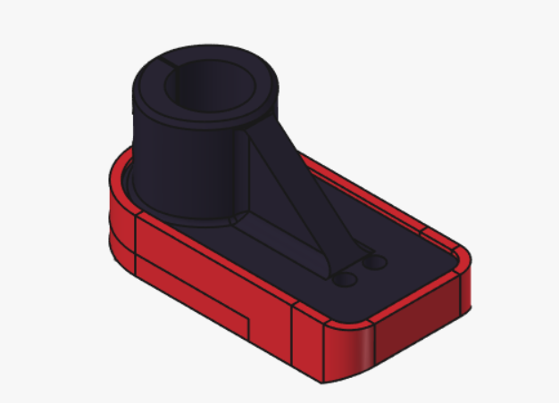
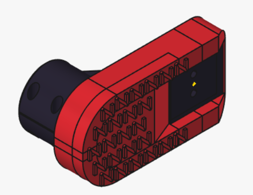
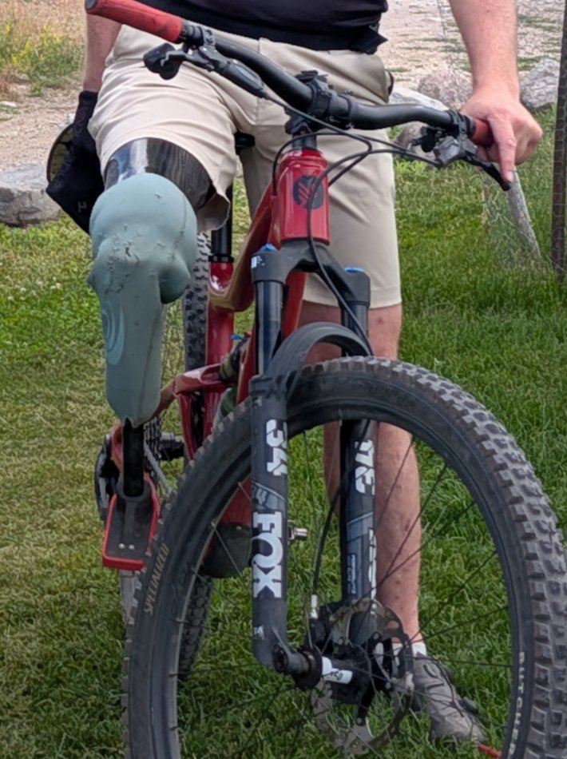

# Cycle Foot

An open-source, 3D-printable **cycling foot for lower-limb prosthetics**. It
clamps onto a standard 30 mm pylon tube in place of a regular prosthetic
foot and gives you a cleat mount on the underside of the foot, so you can clip into
clipless bike pedals. A separate printed sole with a grip pattern lets you
walk short distances off the bike.

Designed by an amputee, for amputees, in [FreeCAD](https://www.freecad.org/).
It supports SPD and Crank Brothers cleats. The cleat sits 70 mm in front of
the pylon, which lets me unlock my Össur Total Knee 2100 while
riding. Whether it works for you depends on your knee, alignment and setup.
See [DESIGN.md](DESIGN.md)
for the requirements and what each version taught us.
The model is fully parametric, so the design can be adapted if needed.

**This is a real device in regular use.** I have ridden it for
**219 rides and about 2,878 miles** since December 18, 2023 (as of
November 2026), across three prints and several minor design revisions.

| Top: Foot (black) in the Sole (red) | Bottom: Z-grip pattern and cleat opening | In use |
| --- | --- | --- |
|  |  |  |

*Right: my own setup, an Össur Total Knee 2100, with the cycle foot
clamped to the pylon. A silicone sleeve slides over the outside of the
socket and extends below the knee. It is intended to reduce the risk of the
socket and knee damaging the bike's carbon frame if they hit it, as is the
TPU sole at the foot.*

> ## ⚠️ Safety notice — read before use
>
> This is a **homemade, unregulated prosthetic component**. It is **not** a
> certified medical device and has not been tested to ISO 10328 or any other
> prosthetic standard. A failure while riding can cause serious injury.
>
> - Talk to your prosthetist before using it, and have them check the fit and
>   alignment.
> - Inspect the part for cracks, layer separation or loose hardware **before
>   every ride**. Replace it at the first sign of damage.
> - Start with low-intensity riding and build up gradually.
> - **CRITICAL: Print quality, material and settings strongly affect
>   strength. A part printed by you is only as good as your print.** Do your
>   own validation before relying on it.
>
> You use this design entirely at your own risk. See the disclaimer of
> warranty and limitation of liability in [LICENSE](LICENSE), section 6.

## Printing & setup

### Files

| Part | STL (to print) | STEP (for CAD) |
| --- | --- | --- |
| Foot | [cycle_foot-foot.stl](exports/stl/cycle_foot-foot.stl) | [cycle_foot-foot.step](exports/step/cycle_foot-foot.step) |
| Sole | [cycle_foot-sole.stl](exports/stl/cycle_foot-sole.stl) | [cycle_foot-sole.step](exports/step/cycle_foot-sole.step) |

GitHub shows STL files in a 3D viewer. To download them all at once, use the
[latest release](https://github.com/ZacVawter/cycle_foot/releases/latest).

### Material

#### Foot

I have printed the **Foot** in these two carbon-fibre-filled
nylons:

| Filament | Tensile strength (X–Y) | Data sheet |
| --- | --- | --- |
| Bambu Lab **PAHT-CF** | 88 ± 7 MPa | [TDS](https://cdn.shopify.com/s/files/1/0380/5149/files/Bambu_PAHT-CF_Technical_Data_Sheet.pdf) |
| Bambu Lab **PA6-CF** (current build) | 102 ± 7 MPa | [TDS](https://store.bblcdn.com/b2abc59ac250492b979a52f1ce3e61b3.pdf) |

This is what has worked for one rider, not a validated material
specification. Other filaments with similar published strength may work, but
data-sheet values come from test specimens, not from a printed foot. Your
printer, settings, infill and filament moisture all change the result.
**Whatever you print, do your own validation before relying on it** (see
[DESIGN.md](DESIGN.md#validation)).

**Avoid PLA, resin and PETG for the Foot.** I have broken test feet
printed in PLA and in resin.

Nylon absorbs moisture, which weakens the print. Dry the filament before
printing, following the manufacturer's data sheet, and print from a dry box.

#### Sole

I have printed the **Sole** in Bambu Lab **TPU 95A HF**
([TDS](https://store.bblcdn.com/58df32731eab4c90a7dac9b12e13ba88.pdf)). The Sole
isn't structural. The soft TPU is intended to help protect the bike if the
foot hits the frame, and to grip on a range of surfaces when you walk. Other
TPUs of similar hardness (Shore 95A) are a reasonable starting point.

### Print settings (Foot)

| Setting | Value |
| --- | --- |
| Infill | **80% or more** |
| Orientation | Foot bed flat on the build plate, or tilted up to **20° toe-up** |

The reasoning: 3D-printed parts are usually weakest where one layer joins the
next. With the foot bed flat, the pylon clamp's hoop stress (from tightening
the clamp bolts) and the load spread across the foot bed are intended to run
mainly *along* the layers. Tilts of up to 20° toe-up have also been used.

**After printing, clear the pylon clamp slot.** The slot is narrow, and the
printer often bridges across it, which joins the two sides of the clamp and
makes it hard to tighten. Open it up fully before assembly. A sharp knife may
be needed.

### Installing the heat-set inserts

The Foot uses tapered brass heat-set inserts. The holes are already shaped to
fit them. **Do NOT drill** them.

| Location | Qty | Insert | McMaster-Carr |
| --- | --- | --- | --- |
| Cleat mount | 2 | M5 × 0.8, tapered | [94180A361](https://www.mcmaster.com/94180A361/) |
| Pylon clamp | 3 | M4 × 0.7, 7.9 mm long, tapered | [94180A353](https://www.mcmaster.com/94180A353/) |

1. Let the print cool completely. Clear any stringing or debris from the
   holes.
2. Fit a soldering iron with a heat-set insert tip that matches the thread
   size, and set it to about your filament's printing temperature.
3. Put the insert in the hole, small end down, and check that it is square.
   Install the **cleat inserts from the top of the foot bed**, so they sit on
   the shelf and the cleat pulls them *into* the part rather than out of it.
4. Press down gently and let the heat do the work. Don't force it. Stop when
   the insert is flush with the surface.
5. While the plastic is still soft, take the iron away and press the insert
   flat with something cool and flat, such as the side of a wrench, to keep
   it square. Hold it for a few seconds.
6. Let it cool fully. Then test-fit each bolt by hand before the final
   assembly.

### Bolts and assembly

| Item | Qty | Notes |
| --- | --- | --- |
| M4 × 20 mm socket head cap screw | 3 | Pylon clamp. Passes through the 4.3 mm clearance holes into the M4 inserts. |
| Cleat and M5 cleat bolts | 1 set | SPD or Crank Brothers, as supplied with your pedals |
| Crankbrothers MTB Shoe Shields | 1 | Thin metal plate fitted between the cleat and the print |

1. Fit a **Crankbrothers Shoe Shield** between the cleat and the foot bed. It
   helps protect the printed surface from the cleat digging in and wearing
   it away. You may need slightly longer cleat bolts to allow for its thickness.
   Check that each bolt engages the full length of its insert.
2. Bolt the cleat on through the shield into the M5 inserts.
3. Slide the Foot onto the pylon and tighten the three M4 clamp bolts evenly.
   Check that the foot can't rotate on the pylon before you ride.

## Design changes and contributing

Most people only need the sections above. If you want or need to make design
changes, see **[DESIGN.md](DESIGN.md)**. It covers the design parameters, how
to re-run the structural analysis (FEA), the requirements, and what earlier
versions taught us.

Further design analysis is especially welcome, including academic work:
more detailed FEA (for example anisotropic material models or modelled
inserts), physical static and fatigue testing of printed parts, or studies
with other riders and setups. Open an issue to get in touch.

Ride reports, fit changes, photos and design improvements are welcome too. Open an
issue or a pull request. If you change the geometry or material, re-run the
FEA, commit the updated `cad/cycle_foot.FCStd`, **and** re-run
`tools/export.py` so the STEP/STL files match the source.

## License

Copyright © 2023–2026 Zac Vawter.

This hardware design is licensed under the **CERN Open Hardware Licence Version
2 – Strongly Reciprocal** ([CERN-OHL-S-2.0](LICENSE)). You may use, study,
modify, make and sell products from it. If you distribute a modified version
(or products made from one), you must release your modified source under the
same licence.

Source location: <https://github.com/ZacVawter/cycle_foot>

The software in `tools/` is covered by the same licence.
